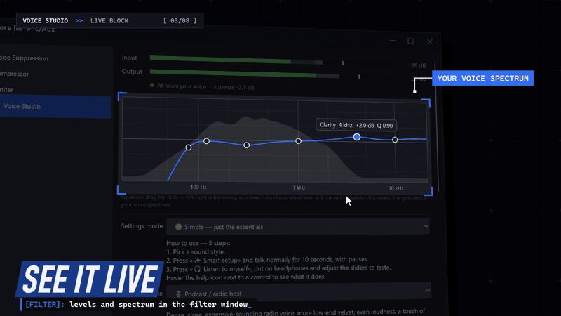
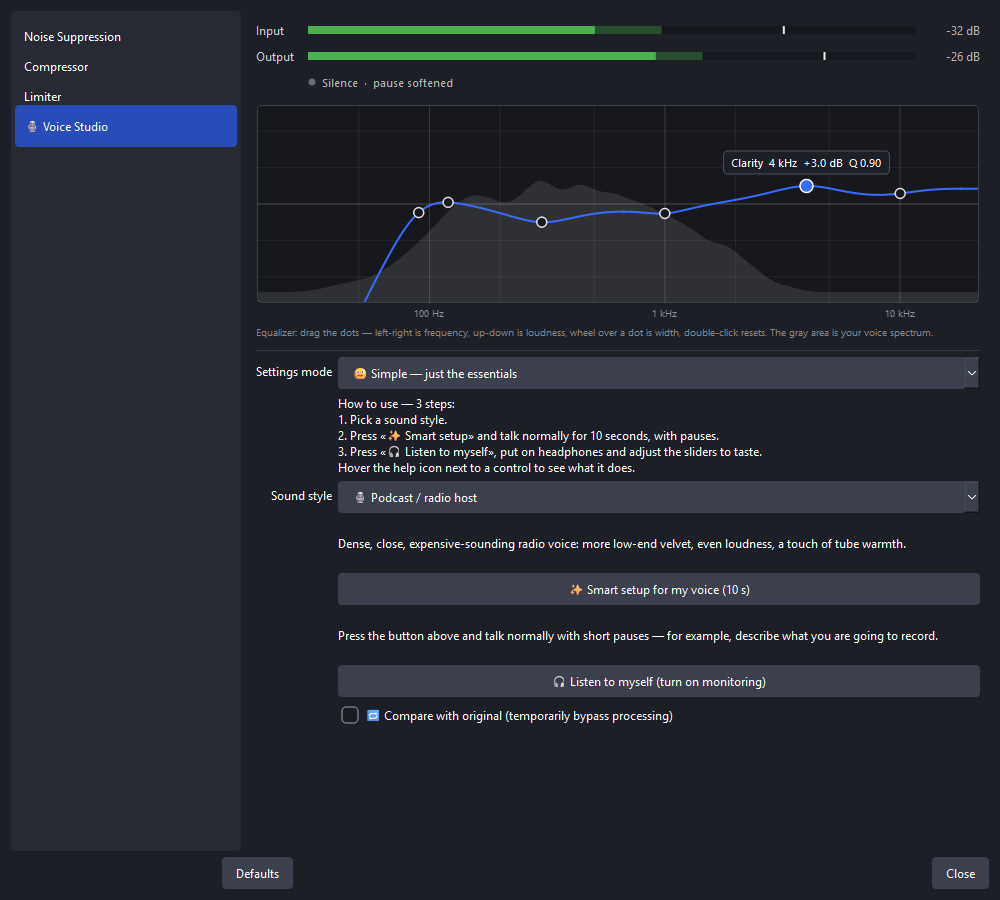
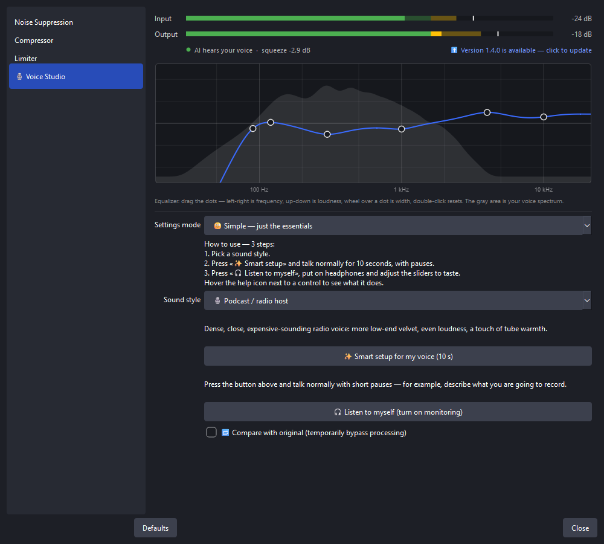

# 🎙 Voice Studio — microphone processing plugin for OBS Studio

**English** · [Русский](README.ru.md)

**Voice Studio is a free OBS Studio plugin that makes any microphone sound clean and studio-like.**
AI noise suppression (RNNoise), a one-click *Smart setup*, an equalizer you drag with the mouse on top of your live
voice spectrum, a compressor, a de-esser, tube warmth and a formant-preserving voice changer, all in one OBS filter.
You don't need VST plugins or audio-engineering skills.

[](https://github.com/Agrysif/obs-voice-studio/releases/latest)




▶ **Demo video (36 s):** [demo-en.mp4](voice-studio/docs/demo-en.mp4) ·
[all screenshots](voice-studio/docs)

## Why Voice Studio

- **One filter instead of five.** Noise suppression, gate, EQ, de-esser, compressor and limiter are chained in the
  right order inside one OBS filter.
- **Made for beginners.** Pick a style, press **✨ Smart setup** and talk for 10 seconds. The plugin measures your voice
  and room noise and sets every parameter for you.
- **You see what you hear.** A live block in the filter window shows input/output levels, whether the AI hears your
  voice, compression, and an EQ curve over your real voice spectrum.
- **Light and fast.** About 1% of one CPU core for a typical microphone, about 31 ms of processing latency.
- **Updates itself.** New versions come from GitHub Releases and are checked with a digital signature before they
  are installed.

## Features

| | What it does | Under the hood |
|---|---|---|
| 🤖 **AI noise suppression** | Removes fans, PC hum, street noise, keyboard clicks | **RNNoise 0.2** neural network (Xiph.Org), AVX2/SSE4.1 picked automatically |
| ✨ **Smart setup** | Tunes gain, denoiser, gate, compressor, de-esser and EQ to *your* voice in 10 seconds | Voice activity detection + comparison with the long-term average speech spectrum (LTASS) |
| 🚪 **Smart noise gate** | Silence between phrases | Can open **by voice** (AI speech detector) instead of loudness, so keyboard clicks don't open it |
| 🎚 **Equalizer** | Depth, boominess, nasality, clarity, air + low-cut | 5 bands + filters, draggable curve over the live spectrum |
| 🐍 **De-esser** | Softens harsh "s", "sh" | Reacts to the share of sibilance, not loudness |
| 🗜 **One-knob compressor** | Even loudness, a "radio" voice | Automatic makeup gain |
| 🔥 **Warmth** | Tube-like harmonics | Asymmetric soft saturation |
| 🎭 **Voice changer** | Pitch ±12 semitones and voice "size" | Phase vocoder **with formant preservation**, no chipmunk effect |
| 🛡 **Limiter** | Stops clipping when you shout or laugh | 1.5 ms look-ahead |
| 🎧 **Listen to myself** | One button turns on monitoring of the processed voice | OBS audio monitoring |
| 🔁 **Compare with original** | Before/after checkbox | No time jump when switching |

**10 ready styles:** 🌿 Natural · 🎙 Podcast / radio host · 🎮 Streaming and gaming · 🌙 Deep and velvety ·
✨ Bright and crisp · 🏠 Noisy room · 🧹 Only remove noise · 📞 Phone / radio · 👹 Monster · 🐿 Cartoon.

Two interface modes: **Simple** (just the clear sliders) and **Expert** (frequencies, Q, attack, release…).
Every control has a tooltip that explains it in plain words.



## Download and install

1. Download `voice-studio-<version>-windows-x64.zip` from
   **[Releases](https://github.com/Agrysif/obs-voice-studio/releases/latest)**.
2. Unzip it and double-click **`install.cmd`**. You don't need administrator rights.
3. Restart OBS.

The plugin goes to `C:\ProgramData\obs-studio\plugins\voice-studio`, the standard folder for third-party OBS plugins.
You can also copy the `voice-studio` folder from the zip there yourself.
To remove it, close OBS and run `uninstall.cmd`.

**Requirements:** OBS Studio 32, Windows 10/11 64-bit.

## How to use

1. In OBS, open the **Audio Mixer**, click **⋮** next to your microphone, then **Filters**.
2. Click **+** at the bottom left and choose **🎙 Voice Studio**.
3. Pick a **sound style**.
4. Press **✨ Smart setup** and talk normally for 10 seconds, with pauses.
5. Put on headphones and press **🎧 Listen to myself**. Move the sliders and toggle **Compare with original** to hear
   the difference.

### Tips

- **Listen to yourself only with headphones.** Otherwise the mic picks up your speakers and you get echo or feedback.
- If the mic already has OBS filters like *Noise Suppression*, *Noise Gate* or *Compressor*, turn them off:
  Voice Studio does all of that, and double processing makes the sound worse.
- Voice sounds hollow or loses word endings → lower the noise suppression **Strength** to 70–85%.
- Quiet words get cut → switch the gate to **🤖 By voice** or lower the **Silence threshold**.
- Harsh voice → lower *Clarity* and *Air*, raise the de-esser.
- The OBS mixer meter should reach the yellow zone, not the red one.

## Automatic updates



- When OBS starts (at most once a day), the plugin checks GitHub Releases for a new version.
- When there is one, you see a dialog with the release notes and **Update / Later / Skip this version**. The filter
  window also shows **⬆ Version X is available**.
- The update downloads in the background. Its description is signed with the author's **ECDSA P-256** key, and the
  plugin checks the signature and the SHA-256 of the package before it changes any file. A forged update is rejected,
  even if someone gets access to the GitHub page.
- The new version starts after an OBS restart. If something goes wrong, the old files are restored.
- Settings: **Tools → 🎙 Voice Studio** → *Check for updates*, *Check for updates automatically*, *Project page*.

Privacy: the plugin only connects to `github.com` to check for updates. It sends no data besides a normal HTTPS request
(the User-Agent has the plugin and OBS versions). You can turn automatic checks off in the menu.

## Languages

The plugin uses the OBS interface language: English, Русский, Беларуская, Українська, Қазақша, Кыргызча,
Oʻzbekcha, Тоҷикӣ, Azərbaycanca, Հայերեն, Татарча, Башҡортса.

OBS Studio 32 doesn't offer Kazakh, Kyrgyz or Tajik in its own language list yet. The translations are already
included and will turn on automatically once OBS adds those languages. Fixes from native speakers are welcome. The
files are in [`voice-studio/data/locale`](voice-studio/data/locale).

## Latency and CPU

| What is on | Latency |
|---|---|
| Normal processing (with AI denoiser) | ≈ 31 ms |
| + voice changer, "High" quality | ≈ 74 ms |
| + voice changer, "Fast" quality | ≈ 53 ms |

If lips on video slightly miss the sound, set *Advanced Audio Properties → Sync Offset*.
CPU: ≈1% of one core for a mono mic, ≈4% in stereo with every effect on.

## FAQ

**Is this a VST plugin?** No, it's a native OBS filter, so you don't need a VST host or extra licenses. It replaces a
chain of VST plugins (denoiser + EQ + compressor + de-esser + limiter).

**How is it better than the built-in OBS noise suppression?** It uses the newer RNNoise 0.2 model. The gate can open
by voice instead of loudness, and Smart setup tunes the whole chain to your voice and room.

**macOS / Linux?** Not yet, Windows only for now.

**Does it work for recording, not just streaming?** Yes, it's a regular audio filter, so it works for recordings,
streams, virtual camera and everything else.

## Build from source

You need Visual Studio 2022 with C++, Git and an installed OBS Studio. You don't need to build OBS itself: the script
downloads the matching libobs headers and the official OBS Qt package (verified by SHA-256).

```powershell
cd voice-studio
.\build.ps1 -Test        # build + all checks (DSP, libobs host test, updater self-test)
.\build.ps1 -Install     # build and install into OBS
```

Developer notes (code layout, tests, release process): [voice-studio/README.md](voice-studio/README.md).

## License

GPL-2.0-or-later (the plugin links with libobs). RNNoise is BSD-3-Clause, © Xiph.Org Foundation and contributors.

---

*Keywords: OBS plugin, OBS Studio microphone filter, OBS noise suppression plugin, RNNoise for OBS, AI noise removal,
OBS equalizer, OBS compressor, de-esser, voice changer for OBS, VST alternative, streaming microphone setup, podcast
voice, Twitch, YouTube.*
