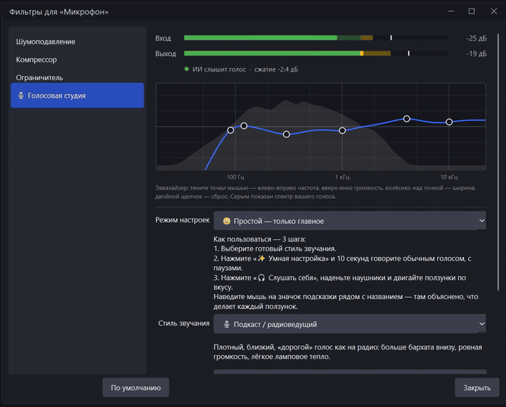
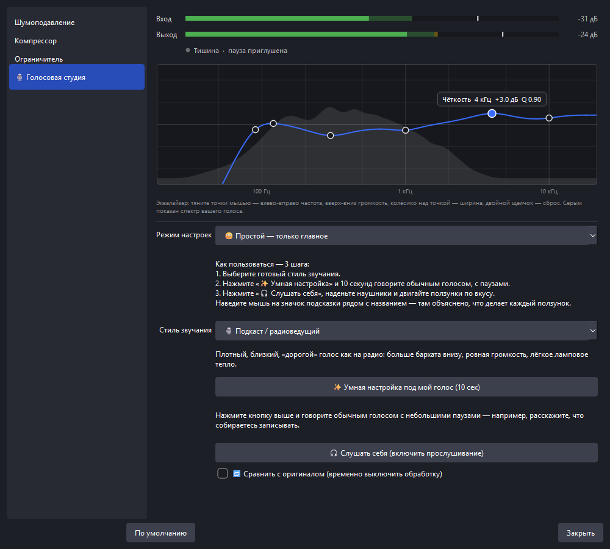
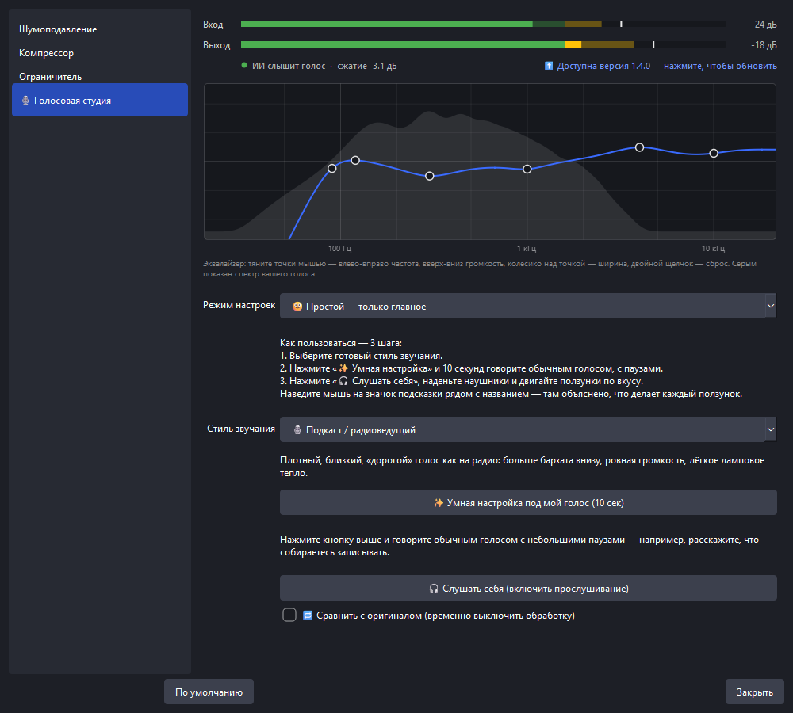

# 🎙 Голосовая студия — плагин обработки микрофона для OBS Studio

[English](README.md) · **Русский**

**Голосовая студия — бесплатный плагин для OBS Studio, с которым любой микрофон звучит чисто и по-студийному.**
В одном фильтре OBS собраны ИИ-шумоподавление (RNNoise), «Умная настройка» в одно нажатие, эквалайзер (его точки
тянутся мышью прямо поверх живого спектра голоса), компрессор, де-эссер, ламповое тепло и смена голоса с сохранением
формант. VST-плагины и знания звукорежиссуры не нужны.

[](https://github.com/Agrysif/obs-voice-studio/releases/latest)


**Скачать:** https://mytoolkit.ru/programmy/voice-studio



▶ **Видео за 35 секунд, с музыкой:** [demo-ru.mp4](voice-studio/docs/demo-ru.mp4) ·
[все скриншоты](voice-studio/docs)

## Почему Голосовая студия

- **Один фильтр вместо пяти.** Шумодав, гейт, эквалайзер, де-эссер, компрессор и лимитер стоят в одном фильтре OBS,
  в правильном порядке.
- **Сделан для новичков.** Выберите стиль, нажмите **✨ Умная настройка** и говорите 10 секунд. Плагин измерит голос
  и шум комнаты и сам выставит все параметры.
- **Видно, что слышно.** В окне фильтра есть живой блок: уровни «Вход/Выход», слышит ли ИИ голос, работа
  компрессора и кривая эквалайзера поверх настоящего спектра вашего голоса.
- **Лёгкий.** Около 1% одного ядра процессора на обычный микрофон, задержка обработки около 31 мс.
- **Обновляется сам.** Новые версии приходят из GitHub Releases. Перед установкой плагин проверяет их цифровую
  подпись.

## Что умеет

| | Что делает | Что под капотом |
|---|---|---|
| 🤖 **ИИ-шумоподавление** | Убирает вентилятор, гул ПК, улицу, клавиатуру | Нейросеть **RNNoise 0.2** (Xiph.Org), ускорение AVX2/SSE4.1 выбирается само |
| ✨ **Умная настройка** | За 10 секунд подбирает усиление, шумодав, гейт, компрессор, де-эссер и эквалайзер под *ваш* голос | Детектор речи + сравнение со средним спектром речи (LTASS) |
| 🚪 **Умный шумовой гейт** | Тишина между фразами | Открывается **по голосу** (ИИ-детектор речи), а не по громкости, и не реагирует на клавиатуру |
| 🎚 **Эквалайзер** | Глубина, гулкость, гнусавость, чёткость, воздух + срез гула | 5 полос + фильтры, кривую можно тянуть мышью поверх спектра |
| 🐍 **Де-эссер** | Смягчает резкие «с», «ш», «щ» | Срабатывает по доле шипящих, а не по громкости |
| 🗜 **Компрессор «одной ручкой»** | Ровная громкость, «радийный» голос | Автокомпенсация громкости |
| 🔥 **Тепло** | Ламповые гармоники, бархатность | Асимметричное мягкое насыщение |
| 🎭 **Изменение голоса** | Высота ±12 полутонов и «размер» голоса | Фазовый вокодер **с сохранением формант**, без эффекта бурундука |
| 🛡 **Лимитер** | Голос не хрипит на крике и смехе | С заглядыванием вперёд на 1,5 мс |
| 🎧 **Слушать себя** | Одна кнопка включает прослушивание обработанного голоса | Мониторинг OBS |
| 🔁 **Сравнить с оригиналом** | Галочка «до/после» | Без скачка во времени при переключении |

**10 готовых стилей:** 🌿 Естественный · 🎙 Подкаст/радиоведущий · 🎮 Стрим и игры · 🌙 Глубокий бархатный ·
✨ Яркий · 🏠 Шумная комната · 🧹 Только убрать шум · 📞 Телефон/рация · 👹 Монстр · 🐿 Мультяшный.

Два режима: **Простой** (только понятные ползунки) и **Эксперт** (частоты, добротность, атака, восстановление…).
У каждого ползунка есть подсказка простыми словами.



## Скачать и установить

1. Скачайте `voice-studio-<версия>-windows-x64.zip` со страницы
   **[Releases](https://github.com/Agrysif/obs-voice-studio/releases/latest)**.
2. Распакуйте архив и дважды щёлкните **`install.cmd`**. Права администратора не нужны.
3. Перезапустите OBS.

Плагин ставится в `C:\ProgramData\obs-studio\plugins\voice-studio`. Это стандартная папка для сторонних плагинов
OBS, папку `voice-studio` из архива можно скопировать туда и вручную.
Чтобы удалить плагин, закройте OBS и запустите `uninstall.cmd`.

**Нужно:** OBS Studio 32, Windows 10/11, 64 бит.

## Как пользоваться

1. В OBS, в **Микшере аудио**, нажмите **⋮** у микрофона → **Фильтры**.
2. Нажмите **+** внизу слева → **🎙 Голосовая студия**.
3. Выберите **стиль звучания**.
4. Нажмите **✨ Умная настройка** и 10 секунд говорите обычным голосом, с паузами.
5. Наденьте наушники и нажмите **🎧 Слушать себя**. Подвигайте ползунки и ставьте или снимайте галочку
   «Сравнить с оригиналом», чтобы услышать разницу.

### Советы

- **Слушайте себя только в наушниках.** Иначе микрофон услышит колонки, и будет эхо или свист.
- Если у микрофона уже стоят фильтры OBS «Шумоподавление», «Шумовой гейт» или «Компрессор», отключите их.
  Голосовая студия делает всё это сама, а двойная обработка портит звук.
- Голос «как в трубе» или проглатываются окончания → уменьшите **Силу** шумоподавления до 70–85%.
- Обрезаются тихие слова → в гейте выберите «🤖 По голосу» или сдвиньте **Порог тишины** влево.
- Голос резкий → уменьшите «Чёткость» и «Воздух», добавьте силу де-эссера.
- Индикатор громкости в микшере OBS должен доходить до жёлтой зоны, но не до красной.

## Автообновление



- При запуске OBS (не чаще раза в сутки) плагин проверяет, нет ли новой версии в GitHub Releases.
- Если новая версия есть, появится окно с описанием изменений и кнопками **Обновить / Позже / Пропустить эту
  версию**. В окне фильтра тоже появится надпись **⬆ Доступна версия …**.
- Обновление скачивается в фоне. Его описание подписано ключом автора (**ECDSA P-256**). Плагин проверяет подпись
  и SHA-256 пакета до того, как поменяет хоть один файл. Подделку он не примет, даже если кто-то получит доступ к
  странице на GitHub.
- Новая версия включится после перезапуска OBS. Если что-то пошло не так, прежние файлы вернутся на место.
- Настройки: **Сервис → 🎙 Голосовая студия** → «Проверить обновления», «Проверять обновления автоматически»,
  «Страница проекта на GitHub».

Приватность: плагин обращается только к `github.com`, чтобы проверить обновления, и ничего не отправляет, кроме
обычного HTTPS-запроса (в User-Agent указаны версии плагина и OBS). Автопроверку можно выключить в меню.

## Языки

Плагин говорит на языке интерфейса OBS: English, русский, беларуская, українська, қазақша, кыргызча, oʻzbekcha,
тоҷикӣ, azərbaycanca, հայերեն, татарча, башҡортса.

В OBS Studio 32 пока нельзя выбрать казахский, киргизский и таджикский. Переводы уже лежат в плагине и включатся
сами, когда эти языки появятся в OBS. Правки от носителей языка очень приветствуются, файлы лежат в
[`voice-studio/data/locale`](voice-studio/data/locale).

## Задержка и нагрузка

| Что включено | Задержка |
|---|---|
| Обычная обработка (с ИИ-шумодавом) | ≈ 31 мс |
| + изменение голоса, «Высокое» качество | ≈ 74 мс |
| + изменение голоса, «Быстрое» качество | ≈ 53 мс |

Если губы на видео чуть не совпадают со звуком, задайте *Расширенные свойства аудио → Сдвиг синхронизации*.
Нагрузка: ≈1% одного ядра на моно-микрофон, ≈4% в стерео со всеми эффектами.

## Вопросы и ответы

**Это VST-плагин?** Нет, это родной фильтр OBS: VST-хост и лицензии не нужны. Он заменяет цепочку из
VST-плагинов (шумодав + эквалайзер + компрессор + де-эссер + лимитер).

**Чем лучше встроенного шумоподавления OBS?** В плагине более новая модель RNNoise 0.2. Гейт открывается по голосу,
а не по громкости. Умная настройка подгоняет всю цепочку под ваш голос и комнату.

**macOS / Linux?** Пока только Windows.

**Работает для записи, а не только для стрима?** Да. Это обычный аудиофильтр, он работает в записи, трансляции,
виртуальной камере и везде, где звучит микрофон.

## Сборка из исходников

Нужны Visual Studio 2022 с C++, Git и установленный OBS Studio. Сам OBS собирать не нужно: скрипт скачает
заголовки libobs нужной версии и официальный пакет Qt от разработчиков OBS (с проверкой SHA-256).

```powershell
cd voice-studio
.\build.ps1 -Test        # сборка + все проверки (DSP, тест в libobs, самопроверка обновлений)
.\build.ps1 -Install     # собрать и установить в OBS
```

Устройство кода, проверки и выпуск новой версии описаны в [voice-studio/README.md](voice-studio/README.md).
Шаблон для нового плагина лежит в [`_template`](_template).

## Лицензия

GPL-2.0-or-later (плагин линкуется с libobs). RNNoise — BSD-3-Clause, © Xiph.Org Foundation и др.

---

*Ключевые слова: плагин OBS, обработка голоса в OBS, шумоподавление микрофона OBS, как убрать шум микрофона в OBS,
RNNoise, ИИ-шумодав, эквалайзер OBS, компрессор OBS, де-эссер, изменение голоса OBS, замена VST, настройка
микрофона для стрима, голос для подкаста, Twitch, YouTube.*
